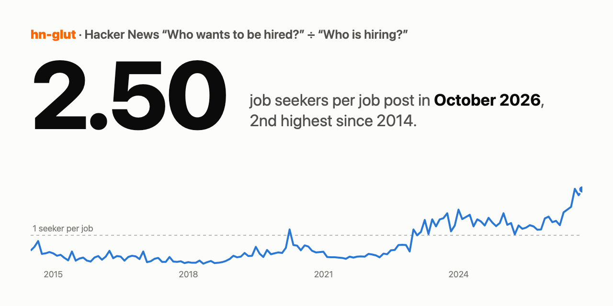

# hn-glut

[](https://github.com/majiayu000/hn-glut/actions/workflows/ci.yml)
[](LICENSE)

**October 2026: 2.50 job seekers for every job post on Hacker News.** 799 top-level comments in “Ask HN: Who wants to be hired?” against 319 in “Ask HN: Who is hiring?”. August (2.52), October and September (2.31) 2026 are the three highest months since the two threads started running side by side in July 2014. In October 2021 the ratio was 0.30.

[](https://majiayu000.github.io/hn-glut/)

**Live chart:** https://majiayu000.github.io/hn-glut/ · **Data:** [`data/monthly.csv`](data/monthly.csv), [`data/skills.csv`](data/skills.csv), [`data/jolts.csv`](data/jolts.csv), [`data/hn-glut.json`](data/hn-glut.json)

hn-glut counts the top-level comments in every monthly `whoishiring` thread since 2014, divides seekers by job posts, splits the ratio by skill (“how many Rust job seekers per Rust job post”), and puts the US JOLTS openings-per-unemployed ratio next to it. It is a small offline-capable Python CLI that writes CSV/JSON, a single static page that charts it, and a monthly GitHub Action.

## Highest months since July 2014

| Month | Seekers | Job posts | Seekers per job post | Visible today |
|---|---:|---:|---:|---:|
| 2026-08 | 667 | 265 | **2.52** | 555 / 227 = 2.44 |
| 2026-10 | 799 | 319 | **2.50** | 695 / 266 = 2.61 |
| 2026-09 | 694 | 300 | **2.31** | 538 / 248 = 2.17 |
| 2026-07 | 601 | 311 | **1.93** | 489 / 258 = 1.90 |
| 2024-01 | 581 | 315 | **1.84** | 446 / 278 = 1.60 |

Yearly averages (all comments): 2018 0.13, 2021 0.29, 2023 1.31, 2024 1.48, 2025 1.31, 2026 (Jan–Oct) 1.83. The lowest month is May 2018 at 0.07. For comparison, the US had 1.01 job openings per unemployed person in August 2026 (JOLTS ÷ CPS, preliminary).

Numbers from `hn-glut build --jolts` run on 2026-10-25. The October thread closes to new comments around 2026-10-15, so its count is final apart from moderation.

## What is counted

Each month has a “Who is hiring?” thread (job posts) and a “Who wants to be hired?” thread (job seekers), both posted by [`whoishiring`](https://news.ycombinator.com/submitted?id=whoishiring) (April and May 2015 by the stand-in account `_whoishiring`). A top-level comment is one job post or one seeker; replies are not counted.

Two definitions, both in the CSV:

| | Source | October 2026 hiring thread |
|---|---|---:|
| **All comments** (headline) | `kids` of the thread in the [HN Firebase API](https://github.com/HackerNews/API): every top-level comment ever posted, including ones later deleted or marked dead | 319 |
| **Visible today** | `children` of the thread in the [HN Algolia API](https://hn.algolia.com/api): comments you can still read | 266 |

Checked on the October 2026 threads: Algolia's visible count equals Firebase `kids` minus deleted minus dead (hiring: 319 = 266 visible + 34 deleted + 19 dead; seekers: 799 = 694 + 86 + 19, Algolia returned 695 because one comment arrived during the minutes the per-item check took).

The headline uses all comments because deletions pile up over the years and hit the two threads unevenly: across 2014–2026, 20.8% of seeker comments are no longer visible, against 6.9% of job posts (people delete their résumé once hired). A visible-only series would make old months look emptier on the seeker side. Sites that read Algolia (for example hnhiringtrends.com) show the visible numbers; hn-glut's `*_visible` columns match them.

Not counted: “Freelancer? Seeking freelancer?” (kept as `freelancer_all`), the March 2020 “Who is hiring right now?” pair, and anything else the accounts posted; see [`data/skipped.csv`](data/skipped.csv). [bilbof/whoishiring-ratio](https://github.com/bilbof/whoishiring-ratio) and some one-off charts use `descendants` / `num_comments`, which include replies, so their ratios differ.

## Ratio by skill

`skills.csv` gives, per month and per skill, how many visible job posts and seeker posts mention the skill, and the seekers-per-job ratio pooled over three months. Matching is one regular expression per skill in [`src/hn_glut/skills.py`](src/hn_glut/skills.py); no LLM. Aug–Oct 2026, skills with at least 20 job-post mentions:

| Skill | Job posts | Seekers | Seekers per job |
|---|---:|---:|---:|
| go | 27 | 303 | 11.22 |
| java | 29 | 291 | 10.03 |
| javascript | 102 | 901 | 8.83 |
| python | 194 | 1,066 | 5.49 |
| llm | 116 | 610 | 5.26 |
| react | 160 | 822 | 5.14 |
| rust | 60 | 247 | 4.12 |
| ai agents | 190 | 536 | 2.82 |
| ml | 116 | 258 | 2.22 |
| security | 103 | 144 | 1.40 |

Read these against each other, not against the overall 2.41 (visible, same months). Seekers usually paste a long “Technologies:” list and job posts name a few tools, so most skills come out above the overall ratio. Some patterns are loose: `security` also matches phrases like “security clearance” or “job security”, `ai agents` matches any “agent”.

## Usage

Requires [uv](https://docs.astral.sh/uv/).

```bash
uv run hn-glut build --jolts
```

```bash
uv run hn-glut show
```

| Flag (`build`) | What it does |
|---|---|
| `--out DIR` | Output directory, default `data` |
| `--cache DIR` | Raw API responses, default `.cache` (gitignored; contains comment text, never commit it) |
| `--since YYYY-MM` | First month, default `2014-07` |
| `--jolts` | Also fetch JOLTS openings and CPS unemployed from FRED |
| `--offline` | Use only the cache; fail if anything is missing |
| `--freeze-days N` | Re-fetch threads younger than N days, default 30 |

A full backfill is about 560 Firebase requests and 296 Algolia requests, sent one at a time (0.2 s apart for Firebase, 1 s for Algolia); it took about half an hour here. Later runs reuse the cache and fetch about 20 requests. The User-Agent names the project and nothing else.

The page is `index.html` at the repository root and reads `data/hn-glut.json`; serve the folder over HTTP to view it locally (`python3 -m http.server`).

## Data and privacy

Only counts are published. Comment text, usernames and contact details stay in the local cache, which is gitignored. The monthly Action caches API responses in GitHub's Actions cache and uploads only `data/`. The job that would commit `data/` back to the repository is disabled (`if: false` in [`update.yml`](.github/workflows/update.yml)).

## Caveats

- HN is a narrow slice: mostly software, US-heavy, and the threads have their own culture. The ratio says how crowded these threads are, not the job market.
- More seeker comments can mean more people looking, or more people who post (and some seeker posts look machine-written; hn-glut does not try to detect that).
- April 2020 is the only month before 2023 above 1 (572 seekers, 480 job posts, ratio 1.19), right after the March 2020 layoffs; it fell back to 0.68 in May.
- FRED has no CPS unemployment value for October 2025 (the survey was not collected during the US federal shutdown), so that month is a gap in `jolts.csv`.

## More

- [docs/research.md](docs/research.md): existing projects and datasets (in Chinese)
- [docs/design.md](docs/design.md): data sources, counting rules, caching (in Chinese)
- [docs/comparison.md](docs/comparison.md): feature comparison with hnhiringtrends.com, hacker-job and others

## License

MIT. HN content belongs to its authors; this repository publishes only aggregate counts derived from the public HN APIs. JOLTS and CPS are US government data via FRED.
